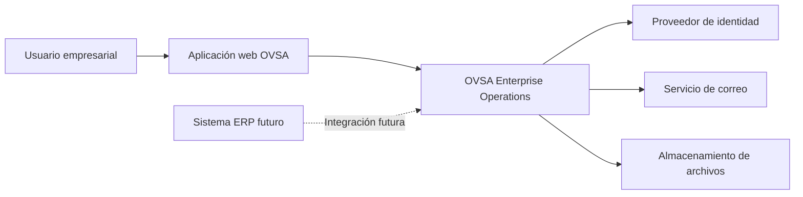
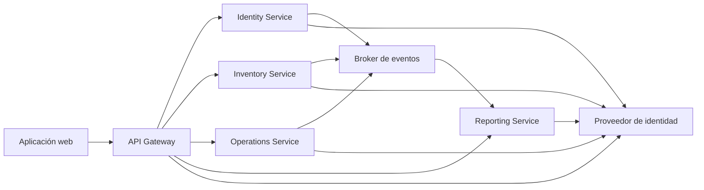

# Límites del sistema

## 1. Propósito

Este documento define qué componentes pertenecen a OVSA Enterprise Operations, qué elementos son externos y cómo se separarán las responsabilidades principales.

---

## 2. Sistema principal

OVSA Enterprise Operations es una plataforma empresarial compuesta por una aplicación web, componentes de plataforma y cuatro microservicios de negocio.

Los cuatro microservicios serán:

1. Identity Service.
2. Inventory Service.
3. Operations Service.
4. Reporting Service.

---

## 3. Componentes internos

### 3.1 Aplicación web

Será la interfaz utilizada por los usuarios.

Responsabilidades:

* Mostrar formularios.
* Mostrar tablas y dashboards.
* Validar formatos básicos.
* Gestionar la navegación.
* Enviar solicitudes al API Gateway.
* Mostrar errores y resultados.

La aplicación web no implementará las reglas empresariales definitivas.

### 3.2 API Gateway

Será el punto de entrada a las API internas.

Responsabilidades:

* Enrutar solicitudes.
* Validar inicialmente el token.
* Propagar identificadores de correlación.
* Aplicar políticas comunes.
* Limitar solicitudes cuando corresponda.
* Centralizar configuración CORS.

El API Gateway no será considerado uno de los cuatro microservicios de negocio.

### 3.3 Identity Service

Será responsable de:

* Organizaciones.
* Sucursales.
* Áreas.
* Usuarios.
* Trabajadores.
* Roles.
* Permisos.
* Relación entre usuarios y trabajadores.

No será responsable de:

* Contraseñas.
* Stock.
* Productos.
* Órdenes de trabajo.
* Reportes empresariales.

### 3.4 Inventory Service

Será responsable de:

* Productos.
* Categorías.
* Proveedores.
* Bodegas.
* Ubicaciones.
* Lotes.
* Stock.
* Entradas.
* Salidas.
* Transferencias.
* Ajustes.
* Mermas.
* Reservas.

No será responsable de:

* Contraseñas.
* Roles.
* Trabajadores.
* Planificación de trabajos.
* Generación consolidada de reportes.

### 3.5 Operations Service

Será responsable de:

* Centros operativos.
* Órdenes de trabajo.
* Tareas.
* Asignaciones.
* Solicitudes de materiales.
* Entregas asociadas a trabajos.
* Devoluciones asociadas a trabajos.
* Evidencias.
* Estados operativos.

No será responsable de:

* Calcular el stock oficial.
* Administrar productos.
* Administrar contraseñas.
* Generar saldos de inventario.
* Administrar roles globales.

### 3.6 Reporting Service

Será responsable de:

* Dashboards.
* Modelos de consulta.
* Reportes.
* Exportaciones.
* Auditoría.
* Alertas.
* Historial consolidado.
* Generación de archivos.

No será responsable de:

* Modificar stock.
* Crear productos.
* Crear trabajadores.
* Completar órdenes de trabajo.
* Autenticar contraseñas.

---

## 4. Componentes de plataforma

Los siguientes elementos formarán parte de la plataforma, pero no serán microservicios de negocio:

* Proveedor de identidad.
* API Gateway.
* Broker de mensajería.
* Base de datos.
* Caché.
* Almacenamiento de archivos.
* Monitoreo.
* Centralización de logs.
* Recolección de métricas y trazas.

---

## 5. Sistemas externos

OVSA podrá relacionarse con componentes externos.

### 5.1 Usuario

Persona que utiliza la aplicación web.

### 5.2 Servicio de correo

Podrá utilizarse para enviar alertas, notificaciones y recuperación de acceso.

### 5.3 Almacenamiento de archivos

Permitirá almacenar reportes, evidencias y documentos generados.

### 5.4 Proveedor de identidad

Administrará autenticación, contraseñas, sesiones y tokens.

### 5.5 Sistemas ERP futuros

Podrán consumir o proporcionar información en futuras versiones.

Los ERP externos no formarán parte de la primera versión.

---

## 6. Diagrama de contexto



---

## 7. Diagrama de límites internos



---

## 8. Propiedad de los datos

Cada microservicio será propietario de sus datos.

### Identity Service

Propietario de:

* Organizaciones.
* Usuarios.
* Trabajadores.
* Roles.
* Permisos.

### Inventory Service

Propietario de:

* Productos.
* Proveedores.
* Bodegas.
* Stock.
* Movimientos.

### Operations Service

Propietario de:

* Órdenes.
* Tareas.
* Asignaciones.
* Solicitudes de materiales.

### Reporting Service

Propietario de:

* Modelos de lectura.
* Reportes.
* Auditorías.
* Alertas.

---

## 9. Reglas de comunicación

* La aplicación web solo se comunicará con el API Gateway.
* El frontend no accederá directamente a las bases de datos.
* Un microservicio no accederá a las tablas de otro.
* Las consultas inmediatas podrán utilizar REST.
* Las actualizaciones asíncronas utilizarán eventos.
* Los eventos deberán tener versión.
* Las operaciones distribuidas deberán soportar fallos parciales.
* Los servicios deberán validar permisos independientemente.
* Reporting consumirá eventos para construir sus modelos de consulta.
* Inventory será la única fuente oficial del stock.

---

## 10. Ejemplo de responsabilidad correcta

Cuando Operations necesite materiales:

1. Operations crea una solicitud de materiales.
2. Inventory verifica y reserva el stock.
3. Inventory informa el resultado.
4. Operations actualiza el estado de la solicitud.
5. Reporting recibe eventos de ambos servicios.

Operations no deberá modificar directamente el stock.

---

## 11. Ejemplo de responsabilidad incorrecta

No se permitirá que Operations ejecute una consulta como:

```sql
SELECT * FROM inventory.stock_balance;
```

Tampoco se permitirá que Reporting modifique directamente una orden:

```sql
UPDATE operations.work_order
SET status = 'COMPLETED';
```

Estas acciones romperían la independencia de los servicios.

---

## 12. Regla principal

Cada responsabilidad empresarial deberá tener un único propietario.

Cuando dos servicios necesiten colaborar, deberán hacerlo mediante contratos explícitos y no mediante acceso directo a datos internos.
