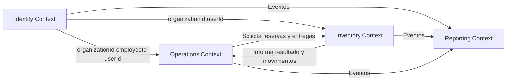

# Dominios y bounded contexts

## 1. Propósito

Este documento define los cuatro dominios principales de OVSA Enterprise Operations y establece las responsabilidades, conceptos y límites de cada uno.

Cada dominio será implementado mediante un microservicio independiente.

Los cuatro bounded contexts son:

1. Identity.
2. Inventory.
3. Operations.
4. Reporting.

---

# 2. Contexto Identity

## 2.1 Propósito

Identity administra la estructura organizacional, las personas registradas y las autorizaciones empresariales de OVSA.

La autenticación de contraseñas será delegada a un proveedor de identidad externo.

## 2.2 Responsabilidades

Identity será responsable de:

* Organizaciones.
* Sucursales.
* Departamentos.
* Usuarios empresariales.
* Trabajadores.
* Roles.
* Permisos.
* Asociación entre usuario y trabajador.
* Activación y desactivación de usuarios.
* Activación y desactivación de trabajadores.
* Contexto multiempresa.

## 2.3 Conceptos principales

### Organization

Representa una empresa o institución que utiliza OVSA.

### Branch

Representa una sucursal perteneciente a una organización.

### Department

Representa un área interna de una organización.

### User

Representa una identidad autorizada para utilizar la plataforma.

Un usuario puede estar relacionado con un trabajador, pero no necesariamente debe estarlo.

### Employee

Representa una persona registrada como trabajador dentro de una organización.

### Role

Agrupa permisos empresariales.

### Permission

Representa una acción específica que puede ser autorizada.

Ejemplos:

* `product:create`
* `stock:view`
* `receipt:confirm`
* `work-order:assign`
* `report:generate`

## 2.4 Agregados iniciales

### Organization Aggregate

```text
Organization
├── Branch
└── Department
```

La organización será responsable de controlar sus sucursales y estructura interna.

### User Aggregate

```text
User
└── UserRole
```

El usuario será responsable de su estado y roles asignados.

### Employee Aggregate

```text
Employee
```

El trabajador mantendrá su información empresarial y asociación organizacional.

### Role Aggregate

```text
Role
└── RolePermission
```

El rol controlará los permisos asociados.

## 2.5 Identificadores compartidos

Identity proporcionará identificadores como:

* `organizationId`
* `branchId`
* `departmentId`
* `userId`
* `employeeId`

Los demás dominios podrán almacenar estos identificadores como referencias, pero no serán propietarios de las entidades originales.

## 2.6 Acciones principales

* Crear organización.
* Crear sucursal.
* Registrar trabajador.
* Crear usuario.
* Activar usuario.
* Desactivar usuario.
* Crear rol.
* Asignar rol.
* Asignar permiso.

## 2.7 Eventos principales

* `OrganizationCreated`
* `OrganizationActivated`
* `OrganizationDeactivated`
* `BranchCreated`
* `EmployeeCreated`
* `EmployeeUpdated`
* `EmployeeDeactivated`
* `UserCreated`
* `UserActivated`
* `UserDeactivated`
* `RoleCreated`
* `RoleAssigned`
* `PermissionAssigned`

## 2.8 Fuera de Identity

Identity no administrará:

* Contraseñas.
* Sesiones técnicas.
* Productos.
* Stock.
* Bodegas.
* Órdenes de trabajo.
* Reportes consolidados.

---

# 3. Contexto Inventory

## 3.1 Propósito

Inventory administra el catálogo de productos, las bodegas, las existencias y todos los movimientos que afectan el stock oficial.

Inventory será la única fuente oficial de stock.

## 3.2 Responsabilidades

Inventory será responsable de:

* Categorías.
* Productos.
* Unidades de medida.
* Proveedores.
* Bodegas.
* Zonas.
* Ubicaciones.
* Lotes.
* Números de serie.
* Stock disponible.
* Stock reservado.
* Stock dañado.
* Entradas.
* Salidas.
* Transferencias.
* Devoluciones.
* Mermas.
* Ajustes.
* Reservas.
* Trazabilidad.

## 3.3 Conceptos principales

### Product

Representa un artículo controlado por inventario.

### Category

Clasifica productos con características relacionadas.

### Supplier

Representa una empresa que suministra productos.

### Warehouse

Representa una instalación donde se almacenan productos.

### StorageLocation

Representa una posición específica dentro de una bodega.

### Lot

Agrupa unidades de un producto con características comunes, como fecha de fabricación o vencimiento.

### StockBalance

Representa el saldo actual de un producto en una ubicación.

### StockMovement

Representa una modificación confirmada del stock.

### Receipt

Documento que representa una entrada de productos.

### Issue

Documento que representa una salida de productos.

### Transfer

Documento que representa el traslado entre ubicaciones o bodegas.

### Waste

Documento que representa la pérdida, daño o inutilización de productos.

### StockReservation

Representa una cantidad separada temporalmente para un proceso específico.

## 3.4 Agregados iniciales

### Product Aggregate

```text
Product
├── ProductIdentifier
├── StockPolicy
└── ProductStatus
```

### Warehouse Aggregate

```text
Warehouse
├── WarehouseZone
└── StorageLocation
```

### Receipt Aggregate

```text
Receipt
└── ReceiptItem
```

### Issue Aggregate

```text
Issue
└── IssueItem
```

### Transfer Aggregate

```text
Transfer
└── TransferItem
```

### Waste Aggregate

```text
Waste
└── WasteItem
```

### StockReservation Aggregate

```text
StockReservation
└── StockReservationItem
```

### Stock Balance Aggregate

```text
StockBalance
```

El saldo deberá protegerse frente a modificaciones concurrentes.

## 3.5 Acciones principales

* Crear producto.
* Actualizar producto.
* Crear bodega.
* Registrar entrada.
* Confirmar entrada.
* Registrar salida.
* Confirmar salida.
* Crear transferencia.
* Despachar transferencia.
* Recibir transferencia.
* Registrar merma.
* Aprobar merma.
* Crear ajuste.
* Reservar stock.
* Liberar reserva.

## 3.6 Eventos principales

* `ProductCreated`
* `ProductUpdated`
* `WarehouseCreated`
* `ReceiptCreated`
* `ReceiptConfirmed`
* `IssueConfirmed`
* `TransferDispatched`
* `TransferCompleted`
* `WasteRegistered`
* `WasteConfirmed`
* `StockAdjusted`
* `StockReserved`
* `StockReservationReleased`
* `StockChanged`
* `LowStockDetected`

## 3.7 Fuera de Inventory

Inventory no administrará:

* Datos personales de trabajadores.
* Roles.
* Contraseñas.
* Órdenes de trabajo.
* Asignaciones laborales.
* Reportes consolidados.

---

# 4. Contexto Operations

## 4.1 Propósito

Operations administra la planificación y ejecución del trabajo empresarial.

Controla órdenes de trabajo, tareas, trabajadores asignados y materiales requeridos.

## 4.2 Responsabilidades

Operations será responsable de:

* Centros operativos.
* Tipos de trabajo.
* Órdenes de trabajo.
* Tareas.
* Prioridades.
* Asignaciones.
* Equipos de trabajo.
* Solicitudes de materiales.
* Confirmación de recepción de materiales.
* Devoluciones asociadas al trabajo.
* Comentarios.
* Evidencias.
* Historial de estados.
* Aprobaciones operativas.

## 4.3 Conceptos principales

### OperationalSite

Representa el lugar donde se realiza una actividad.

### WorkOrder

Representa un trabajo planificado que debe ser ejecutado y controlado.

### WorkOrderTask

Representa una actividad específica perteneciente a una orden.

### Assignment

Representa la asignación de uno o más trabajadores a una orden.

### MaterialRequest

Representa la necesidad de productos para ejecutar una orden.

### MaterialDelivery

Representa la confirmación de materiales entregados para una orden.

### MaterialReturn

Representa materiales no utilizados que regresan al inventario.

### Evidence

Representa un archivo o información que respalda la ejecución de una tarea.

## 4.4 Agregados iniciales

### Operational Site Aggregate

```text
OperationalSite
```

### Work Order Aggregate

```text
WorkOrder
├── WorkOrderTask
├── Assignment
├── WorkOrderComment
└── WorkOrderStatusHistory
```

### Material Request Aggregate

```text
MaterialRequest
└── MaterialRequestItem
```

### Material Delivery Aggregate

```text
MaterialDelivery
└── MaterialDeliveryItem
```

### Material Return Aggregate

```text
MaterialReturn
└── MaterialReturnItem
```

## 4.5 Acciones principales

* Crear orden de trabajo.
* Planificar orden.
* Agregar tarea.
* Asignar trabajador.
* Iniciar orden.
* Pausar orden.
* Reanudar orden.
* Solicitar materiales.
* Confirmar recepción de materiales.
* Registrar devolución.
* Enviar orden a revisión.
* Completar orden.
* Cancelar orden.

## 4.6 Eventos principales

* `WorkOrderCreated`
* `WorkOrderPlanned`
* `EmployeeAssigned`
* `WorkOrderStarted`
* `WorkOrderPaused`
* `WorkOrderResumed`
* `MaterialRequested`
* `MaterialRequestApproved`
* `MaterialDelivered`
* `MaterialReturned`
* `WorkOrderSubmittedForReview`
* `WorkOrderCompleted`
* `WorkOrderCancelled`

## 4.7 Fuera de Operations

Operations no administrará:

* Stock oficial.
* Productos completos.
* Información personal completa de trabajadores.
* Roles.
* Contraseñas.
* Saldos de inventario.
* Reportes consolidados.

Operations podrá almacenar referencias como:

* `employeeId`
* `productId`
* `warehouseId`

Estas referencias no convierten a Operations en propietario de esas entidades.

---

# 5. Contexto Reporting

## 5.1 Propósito

Reporting transforma eventos empresariales en información de consulta, indicadores, reportes, auditorías y alertas.

## 5.2 Responsabilidades

Reporting será responsable de:

* Dashboards.
* Modelos de lectura.
* Reportes.
* Exportaciones.
* Auditorías.
* Alertas.
* Indicadores.
* Historial consolidado.
* Archivos generados.
* Estado de trabajos de generación.

## 5.3 Conceptos principales

### AuditEvent

Representa una acción relevante ejecutada dentro del sistema.

### ReportDefinition

Representa la configuración de un tipo de reporte.

### ReportJob

Representa una solicitud de generación de reporte.

### ReportFile

Representa un archivo generado.

### DashboardSnapshot

Representa indicadores preparados para una consulta rápida.

### Alert

Representa una situación que requiere atención.

### Read Model

Representa datos preparados específicamente para consultas.

## 5.4 Agregados iniciales

### Report Job Aggregate

```text
ReportJob
└── ReportFile
```

### Alert Aggregate

```text
Alert
```

### Audit Event Aggregate

```text
AuditEvent
```

Los modelos de lectura podrán diseñarse de acuerdo con cada consulta y no tendrán que replicar exactamente los modelos transaccionales.

## 5.5 Acciones principales

* Solicitar reporte.
* Procesar reporte.
* Completar reporte.
* Marcar reporte como fallido.
* Descargar reporte.
* Registrar auditoría.
* Crear alerta.
* Reconocer alerta.
* Cerrar alerta.
* Actualizar dashboard.

## 5.6 Eventos consumidos

Reporting consumirá eventos de los demás dominios, por ejemplo:

* `UserCreated`
* `EmployeeCreated`
* `ProductCreated`
* `ReceiptConfirmed`
* `IssueConfirmed`
* `WasteConfirmed`
* `StockChanged`
* `WorkOrderCreated`
* `EmployeeAssigned`
* `MaterialDelivered`
* `WorkOrderCompleted`

## 5.7 Eventos publicados

* `ReportRequested`
* `ReportCompleted`
* `ReportFailed`
* `AlertCreated`
* `AlertAcknowledged`
* `AlertClosed`

## 5.8 Fuera de Reporting

Reporting no deberá:

* Modificar productos.
* Modificar trabajadores.
* Actualizar stock.
* Completar órdenes.
* Asignar roles.
* Confirmar movimientos de inventario.

---

# 6. Mapa de contextos



---

# 7. Relaciones entre contextos

## Identity hacia Inventory

Inventory utilizará:

* `organizationId`
* `userId`

Identity no conocerá los productos ni movimientos de inventario.

## Identity hacia Operations

Operations utilizará:

* `organizationId`
* `employeeId`
* `userId`

Operations no podrá modificar los datos personales del trabajador.

## Operations hacia Inventory

Operations solicitará:

* Verificación de productos.
* Reserva de stock.
* Liberación de reserva.
* Confirmación de salida.
* Registro de devolución.

Inventory decidirá si la operación puede realizarse.

## Dominios hacia Reporting

Identity, Inventory y Operations publicarán eventos.

Reporting consumirá esos eventos y construirá información optimizada para consulta.

---

# 8. Reglas de diseño

* Cada concepto tendrá un único dominio propietario.
* Las referencias externas se realizarán mediante identificadores.
* Ningún contexto accederá directamente a las tablas de otro.
* Un servicio no copiará toda la entidad de otro servicio.
* Los comandos se expresarán como acciones.
* Los eventos se expresarán en tiempo pasado.
* Las reglas empresariales vivirán en el dominio correspondiente.
* Reporting no será utilizado para ejecutar operaciones transaccionales.
* Inventory será la única fuente oficial de stock.
* Identity será la única fuente oficial de trabajadores y organizaciones.
* Operations será la única fuente oficial de órdenes de trabajo.
