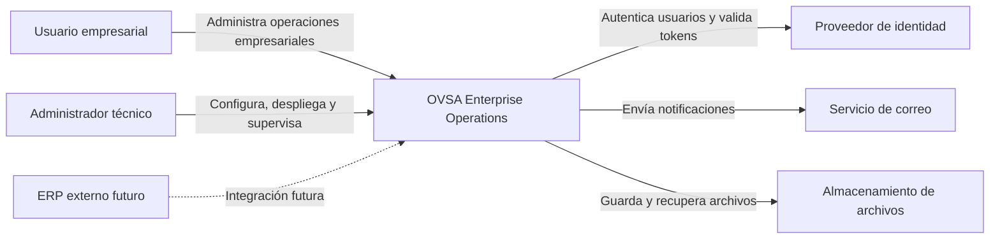

# C4 — Nivel 1: contexto del sistema

## 1. Propósito

Este documento representa a OVSA Enterprise Operations como un sistema completo y muestra las personas y sistemas externos con los que se relaciona.

En este nivel todavía no se muestran microservicios, bases de datos ni detalles internos.

---

## 2. Sistema principal

**OVSA Enterprise Operations** es una plataforma empresarial que permite administrar organizaciones, usuarios, trabajadores, productos, inventario, órdenes de trabajo, materiales, reportes, auditorías y alertas.

---

## 3. Actores

### Usuario empresarial

Persona autorizada que utiliza OVSA desde un navegador web.

Puede desempeñar alguno de los siguientes roles:

* Superadministrador.
* Administrador de empresa.
* Jefe de bodega.
* Operador de bodega.
* Supervisor de operaciones.
* Trabajador.
* Auditor.
* Usuario de consulta.

### Administrador técnico

Persona responsable de desplegar, configurar, supervisar y mantener la plataforma.

No necesariamente administra las operaciones empresariales.

---

## 4. Sistemas externos

### Proveedor de identidad

Sistema responsable de:

* Inicio de sesión.
* Contraseñas.
* Sesiones.
* Tokens.
* Recuperación de acceso.
* Autenticación multifactor futura.

OVSA no almacenará contraseñas de usuarios en sus bases de datos empresariales.

### Servicio de correo

Sistema utilizado para enviar:

* Alertas.
* Notificaciones.
* Confirmaciones.
* Avisos de seguridad.
* Enlaces de recuperación de acceso.

### Almacenamiento de archivos

Servicio utilizado para guardar:

* Reportes PDF.
* Exportaciones Excel.
* Evidencias.
* Documentos generados.
* Archivos adjuntos.

### Sistema ERP futuro

Sistema empresarial externo que podrá integrarse posteriormente con OVSA.

La integración con ERP no forma parte de la primera versión.

---

## 5. Diagrama de contexto

---

## 6. Relaciones principales

| Origen                | Destino                | Relación                                       |
| --------------------- | ---------------------- | ---------------------------------------------- |
| Usuario empresarial   | OVSA                   | Utiliza las funciones de negocio               |
| Administrador técnico | OVSA                   | Configura y supervisa la plataforma            |
| OVSA                  | Proveedor de identidad | Autentica usuarios y valida sesiones           |
| OVSA                  | Servicio de correo     | Envía alertas y notificaciones                 |
| OVSA                  | Almacenamiento         | Guarda reportes, archivos y evidencias         |
| ERP futuro            | OVSA                   | Intercambiará información en versiones futuras |

---

## 7. Límites del sistema

Se considera parte de OVSA:

* Aplicación web.
* API Gateway.
* Identity Service.
* Inventory Service.
* Operations Service.
* Reporting Service.
* Configuración propia de infraestructura.
* Contratos REST.
* Eventos empresariales.
* Reglas de negocio.
* Modelos de datos propios.

No se considera parte de OVSA:

* Navegador del usuario.
* Servicio externo de correo.
* Infraestructura física del proveedor cloud.
* Sistemas ERP de terceros.
* Dispositivos de códigos de barras.
* Aplicaciones móviles futuras.

---

## 8. Decisiones importantes

* El usuario accederá a OVSA mediante una aplicación web.
* La aplicación web será el único cliente oficial de la primera versión.
* El sistema delegará la autenticación a un proveedor especializado.
* Los archivos no se almacenarán directamente dentro de las bases de datos transaccionales.
* Las integraciones futuras deberán utilizar contratos públicos y versionados.
* Los sistemas externos nunca accederán directamente a tablas internas.

---

## 9. Regla del nivel de contexto

Este diagrama debe permanecer sencillo.

No debe mostrar:

* Clases Java.
* Tablas.
* Endpoints.
* Colas específicas.
* Nombres de paquetes.
* Métodos.
* Repositorios.

Esos elementos pertenecen a niveles inferiores de la arquitectura.
