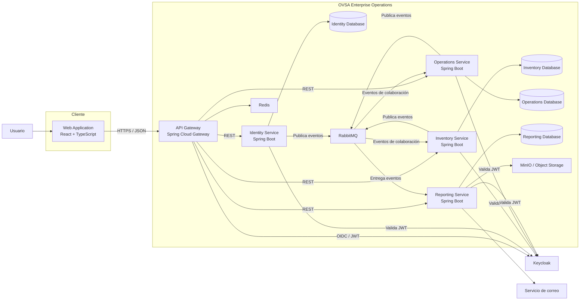
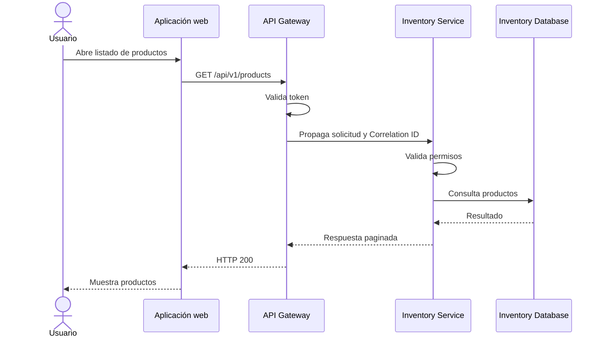
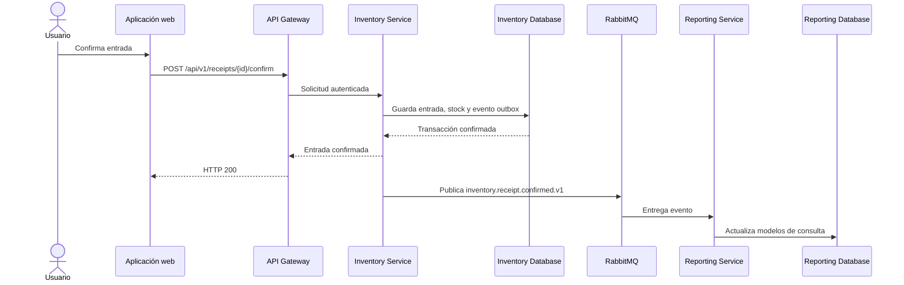
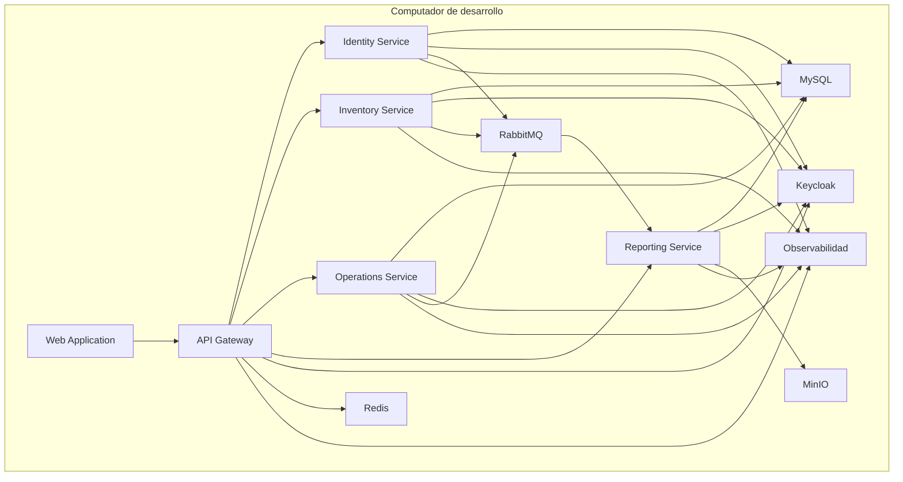

# C4 — Nivel 2: contenedores

## 1. Propósito

Este documento muestra las aplicaciones, servicios, bases de datos y componentes de infraestructura principales que forman OVSA Enterprise Operations.

En este nivel se representan unidades ejecutables y almacenes de datos, pero todavía no se muestran clases Java.

---

# 2. Contenedores de aplicación

## 2.1 Web Application

Aplicación utilizada por los usuarios desde el navegador.

Tecnología planificada:

* React.
* TypeScript.
* Vite.
* Bootstrap.
* TanStack Query.
* React Router.

Responsabilidades:

* Formularios.
* Tablas.
* Navegación.
* Dashboards.
* Validaciones de formato.
* Presentación de errores.
* Comunicación con el API Gateway.

La aplicación web no será responsable de aplicar las reglas empresariales definitivas.

---

## 2.2 API Gateway

Punto de entrada para las solicitudes realizadas por la aplicación web.

Tecnología planificada:

* Java.
* Spring Boot.
* Spring Cloud Gateway.

Responsabilidades:

* Enrutamiento.
* Validación inicial del token.
* Configuración CORS.
* Propagación de `X-Correlation-ID`.
* Rate limiting.
* Políticas comunes.
* Métricas de entrada.

El gateway no implementará reglas de negocio de inventario, operaciones o identidad.

---

## 2.3 Identity Service

Microservicio responsable de:

* Organizaciones.
* Sucursales.
* Departamentos.
* Usuarios empresariales.
* Trabajadores.
* Roles.
* Permisos.

Tendrá una base de datos independiente.

---

## 2.4 Inventory Service

Microservicio responsable de:

* Productos.
* Categorías.
* Proveedores.
* Bodegas.
* Ubicaciones.
* Stock.
* Entradas.
* Salidas.
* Transferencias.
* Mermas.
* Ajustes.
* Reservas.

Será la única fuente oficial del stock.

Tendrá una base de datos independiente.

---

## 2.5 Operations Service

Microservicio responsable de:

* Centros operativos.
* Órdenes de trabajo.
* Tareas.
* Asignaciones.
* Solicitudes de materiales.
* Entregas.
* Devoluciones.
* Evidencias.
* Estados operativos.

Tendrá una base de datos independiente.

---

## 2.6 Reporting Service

Microservicio responsable de:

* Dashboards.
* Modelos de lectura.
* Reportes.
* Exportaciones.
* Auditorías.
* Alertas.
* Archivos generados.

Consumirá eventos de los demás servicios para construir información de consulta.

Tendrá una base de datos independiente.

---

# 3. Contenedores de plataforma

## 3.1 Proveedor de identidad

Administrará:

* Credenciales.
* Inicio de sesión.
* Sesiones.
* Tokens OAuth2 y OpenID Connect.
* Roles técnicos.
* Clientes de aplicación.

Inicialmente se utilizará Keycloak.

---

## 3.2 Broker de mensajería

Permitirá la comunicación asíncrona mediante eventos.

Responsabilidades:

* Publicar eventos.
* Distribuir eventos.
* Reintentar entregas.
* Mantener dead-letter queues.
* Desacoplar productores y consumidores.

Inicialmente se utilizará RabbitMQ.

---

## 3.3 Redis

Se utilizará solamente cuando exista una necesidad concreta.

Posibles responsabilidades:

* Rate limiting.
* Datos temporales.
* Caché.
* Información con tiempo de expiración.

Redis no será la fuente oficial de datos empresariales.

---

## 3.4 Almacenamiento de objetos

Permitirá guardar:

* Reportes.
* Evidencias.
* Exportaciones.
* Archivos adjuntos.

En desarrollo se podrá utilizar MinIO.

---

## 3.5 Plataforma de observabilidad

Permitirá recopilar:

* Logs.
* Métricas.
* Trazas.
* Estado de salud.
* Alertas técnicas.

Componentes previstos:

* OpenTelemetry Collector.
* Prometheus.
* Grafana.
* Loki.
* Tempo o Jaeger.

---

# 4. Diagrama de contenedores



---

# 5. Flujo de una solicitud HTTP

Ejemplo: consultar productos.



---

# 6. Flujo asíncrono

Ejemplo: confirmar una entrada de inventario.



---

# 7. Propiedad de bases de datos

Cada microservicio tendrá una base lógica propia:

```text
ovsa_identity
ovsa_inventory
ovsa_operations
ovsa_reporting
```

Reglas:

* Identity solo accede a `ovsa_identity`.
* Inventory solo accede a `ovsa_inventory`.
* Operations solo accede a `ovsa_operations`.
* Reporting solo accede a `ovsa_reporting`.
* No existirán consultas SQL entre bases de distintos servicios.
* No se utilizarán claves foráneas entre microservicios.
* Las relaciones externas se representarán mediante identificadores.

---

# 8. Protocolos

| Comunicación              | Protocolo               |
| ------------------------- | ----------------------- |
| Navegador hacia Gateway   | HTTPS y JSON            |
| Gateway hacia servicios   | HTTP/HTTPS y JSON       |
| Servicios hacia Keycloak  | OAuth2, OIDC y JWT      |
| Servicios hacia RabbitMQ  | AMQP                    |
| Servicios hacia sus bases | JDBC                    |
| Reporting hacia archivos  | API compatible con S3   |
| Observabilidad            | OTLP, HTTP o Prometheus |

---

# 9. Despliegue inicial

En desarrollo local, los contenedores podrán ejecutarse mediante Docker Compose.



Aunque inicialmente las cuatro bases puedan ejecutarse en una misma instancia MySQL, deberán mantener:

* Esquemas independientes.
* Usuarios independientes.
* Contraseñas independientes.
* Migraciones independientes.
* Permisos independientes.

---

# 10. Despliegue futuro

En un ambiente de producción con mayores necesidades, OVSA podrá desplegarse en Kubernetes o en servicios administrados.

Esto permitirá:

* Réplicas.
* Balanceo.
* Rolling updates.
* Recuperación automática.
* Escalamiento.
* Separación por ambiente.
* Configuración segura de secretos.

Kubernetes no será obligatorio para comenzar el desarrollo.

Primero se deberá conseguir una aplicación correctamente modularizada, probada y observable.

---

# 11. Reglas arquitectónicas

* El frontend solo se comunica con el API Gateway.
* Los microservicios no comparten base de datos.
* Los microservicios validan sus propios permisos.
* El gateway no reemplaza la seguridad de cada servicio.
* Reporting no ejecuta operaciones transaccionales.
* RabbitMQ no será utilizado como base de datos.
* Redis no será utilizado como fuente oficial.
* Los archivos no se guardarán directamente en tablas transaccionales.
* Los contratos HTTP y eventos deberán versionarse.
* Los componentes de infraestructura no se contarán como microservicios empresariales.
