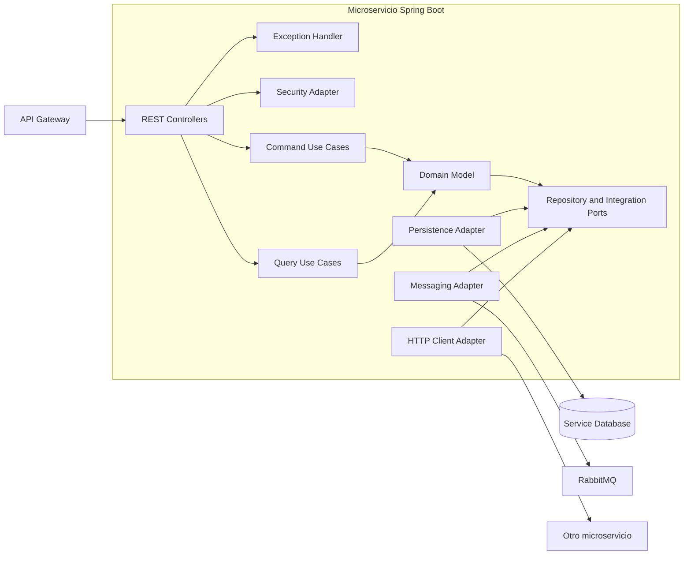
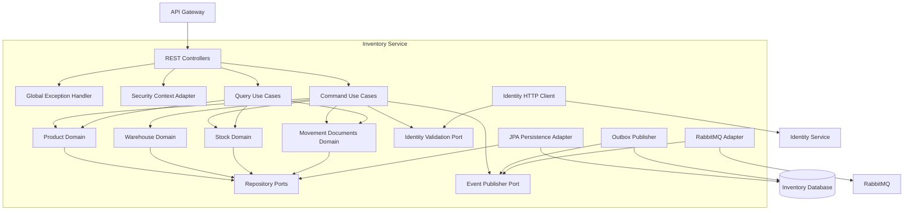
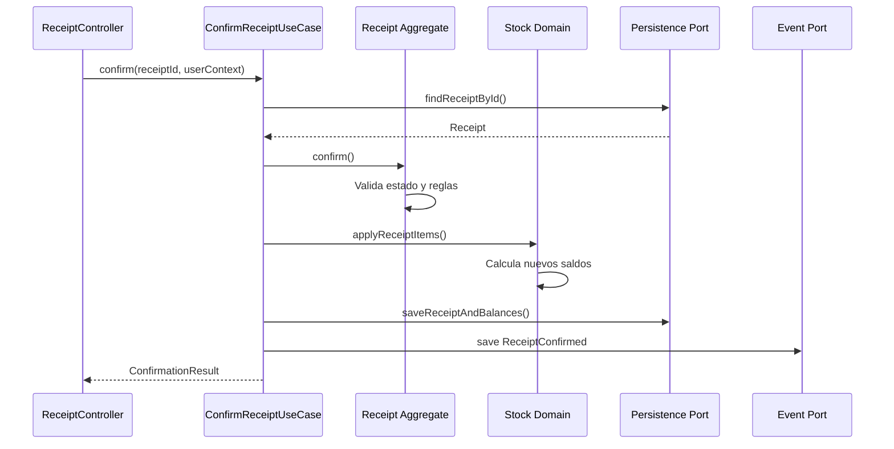

# C4 — Nivel 3: componentes

## 1. Propósito

Este documento muestra cómo se organizarán internamente los microservicios de OVSA.

La estructura se basará en arquitectura hexagonal, también conocida como puertos y adaptadores.

El objetivo es separar:

* Reglas empresariales.
* Casos de uso.
* API REST.
* Persistencia.
* Mensajería.
* Seguridad.
* Integraciones externas.

---

# 2. Capas principales

## 2.1 Domain

Contendrá el modelo y las reglas empresariales.

Ejemplos:

* Agregados.
* Entidades.
* Value objects.
* Eventos de dominio.
* Servicios de dominio.
* Puertos de repositorio.
* Excepciones empresariales.

El dominio no deberá depender de:

* Spring MVC.
* JPA.
* RabbitMQ.
* MySQL.
* Controladores.
* DTO HTTP.

---

## 2.2 Application

Coordinará los casos de uso.

Ejemplos:

* Crear producto.
* Confirmar entrada.
* Reservar stock.
* Liberar reserva.
* Consultar trazabilidad.

Contendrá:

* Commands.
* Queries.
* Casos de uso.
* DTO internos.
* Puertos de entrada.
* Puertos de salida.
* Control transaccional de aplicación.

La capa de aplicación utilizará el dominio, pero no contendrá reglas empresariales profundas que correspondan a los agregados.

---

## 2.3 Interfaces

Permitirá que clientes externos utilicen la aplicación.

Inicialmente contendrá:

* Controladores REST.
* Request DTO.
* Response DTO.
* Validación de solicitudes.
* Manejo global de errores.
* Conversión HTTP.

Los controladores deberán ser pequeños.

Un controlador no deberá calcular stock ni decidir transiciones empresariales.

---

## 2.4 Infrastructure

Implementará detalles técnicos.

Contendrá:

* Entidades JPA.
* Repositorios Spring Data.
* Adaptadores de persistencia.
* Productores y consumidores RabbitMQ.
* Clientes HTTP.
* Configuración de seguridad.
* Configuración de observabilidad.
* Implementaciones de almacenamiento.
* Migraciones Flyway.

Infrastructure dependerá del dominio y la aplicación, pero el dominio no dependerá de Infrastructure.

---

# 3. Diagrama general de componentes



---

# 4. Componentes de Inventory Service

## 4.1 REST API

Responsable de recibir solicitudes relacionadas con:

* Productos.
* Proveedores.
* Bodegas.
* Entradas.
* Salidas.
* Transferencias.
* Mermas.
* Ajustes.
* Reservas.
* Stock.

Ejemplos de futuros controladores:

```text
ProductController
WarehouseController
ReceiptController
IssueController
TransferController
WasteController
StockController
StockReservationController
```

Los controladores:

* Validarán el formato de entrada.
* Obtendrán el contexto del usuario.
* Llamarán a un caso de uso.
* Convertirán el resultado a HTTP.

No accederán directamente a repositorios JPA.

---

## 4.2 Application Use Cases

Casos de uso iniciales:

```text
CreateProductUseCase
UpdateProductUseCase
CreateWarehouseUseCase
CreateReceiptUseCase
ConfirmReceiptUseCase
CreateIssueUseCase
ConfirmIssueUseCase
CreateTransferUseCase
DispatchTransferUseCase
ReceiveTransferUseCase
RegisterWasteUseCase
ConfirmWasteUseCase
ReserveStockUseCase
ReleaseStockReservationUseCase
GetStockQuery
GetProductTraceabilityQuery
```

Cada caso de uso deberá representar una acción o consulta concreta.

No se creará una única clase `InventoryService` con cientos de métodos.

---

## 4.3 Domain Model

Agregados principales:

```text
Product
Warehouse
Receipt
Issue
Transfer
Waste
StockReservation
StockBalance
```

Value objects iniciales:

```text
ProductId
WarehouseId
StorageLocationId
Quantity
Sku
Barcode
LotNumber
MovementReference
```

Servicios de dominio posibles:

```text
StockAvailabilityService
StockMovementFactory
TransferPolicy
WasteApprovalPolicy
```

---

## 4.4 Persistence Adapter

Responsable de implementar los puertos de almacenamiento.

Contendrá:

* Entidades JPA.
* Repositorios Spring Data.
* Mappers.
* Adaptadores.
* Consultas optimizadas.

Ejemplos:

```text
ProductJpaEntity
ProductSpringDataRepository
ProductPersistenceAdapter
ProductPersistenceMapper
```

El dominio utilizará una interfaz conceptual como:

```text
ProductRepository
```

La implementación técnica podrá llamarse:

```text
ProductPersistenceAdapter
```

---

## 4.5 Messaging Adapter

Responsable de:

* Publicar eventos.
* Consumir eventos.
* Leer la tabla outbox.
* Registrar eventos procesados.
* Gestionar reintentos.
* Enviar mensajes fallidos a una DLQ.

Ejemplos de eventos publicados:

```text
inventory.product.created.v1
inventory.receipt.confirmed.v1
inventory.stock.changed.v1
inventory.stock.reserved.v1
inventory.waste.confirmed.v1
```

---

## 4.6 Security Adapter

Responsable de:

* Convertir claims JWT.
* Obtener `organizationId`.
* Obtener `userId`.
* Obtener permisos.
* Exponer el contexto autenticado.
* Validar acceso al recurso.

La seguridad técnica no reemplazará las reglas empresariales.

Por ejemplo, tener el permiso `receipt:confirm` no significa que cualquier entrada pueda confirmarse. La entrada también deberá estar en un estado válido.

---

## 4.7 Observability

Responsable de:

* Logs estructurados.
* Métricas.
* Trazas.
* Correlation ID.
* Health checks.
* Información de errores técnicos.

No deberá registrar:

* Tokens completos.
* Contraseñas.
* Secretos.
* Datos sensibles innecesarios.

---

# 5. Diagrama de Inventory Service



---

# 6. Flujo interno de ejemplo

## Confirmar una entrada



La entrada, los saldos y el evento outbox deberán guardarse dentro de una misma transacción local.

---

# 7. Componentes de los demás servicios

## Identity Service

Componentes principales:

* Organization Management.
* User Management.
* Employee Management.
* Role and Permission Management.
* Identity Provider Adapter.
* Persistence Adapter.
* Event Publisher.

## Operations Service

Componentes principales:

* Work Order Management.
* Task Management.
* Assignment Management.
* Material Request Management.
* Inventory Integration Adapter.
* Persistence Adapter.
* Event Publisher.

## Reporting Service

Componentes principales:

* Event Consumers.
* Audit Processor.
* Read Model Projectors.
* Dashboard Queries.
* Report Generator.
* File Storage Adapter.
* Notification Adapter.
* Alert Management.

---

# 8. Estructura futura de paquetes

Cada microservicio podrá utilizar una estructura similar:

```text
src/main/java/com/ovsa/inventory
├── domain
│   ├── model
│   ├── event
│   ├── repository
│   ├── service
│   └── exception
├── application
│   ├── command
│   ├── query
│   ├── port
│   ├── dto
│   └── usecase
├── infrastructure
│   ├── persistence
│   ├── messaging
│   ├── client
│   ├── security
│   ├── observability
│   └── configuration
└── interfaces
    └── rest
        ├── controller
        ├── request
        ├── response
        └── advice
```

Esta estructura podrá ajustarse cuando exista código real.

No se crearán carpetas vacías solamente para aparentar arquitectura.

---

# 9. Regla de dependencias

La dirección conceptual será:

```text
Interfaces → Application → Domain
Infrastructure → Application y Domain
Domain → No depende de detalles externos
```

No se permitirá:

```text
Domain → Spring Controller
Domain → JPA Entity
Domain → RabbitTemplate
Domain → HttpClient
```

---

# 10. Nivel de código

El nivel 4 de C4 representaría clases, interfaces y relaciones detalladas.

No se documentará manualmente durante Sprint 0 porque todavía no existen clases reales.

Cuando comience la implementación:

* Los nombres de clases deberán reflejar el lenguaje ubicuo.
* Los diagramas de código podrán generarse desde el código.
* La documentación deberá evitar duplicar información que el IDE puede mostrar.
* Se documentarán manualmente solamente las relaciones que aporten valor arquitectónico.

---

# 11. Regla principal

Los diagramas representan decisiones, pero no garantizan que el código las cumpla.

Durante la implementación deberán agregarse pruebas y reglas automáticas para evitar dependencias arquitectónicas incorrectas.
