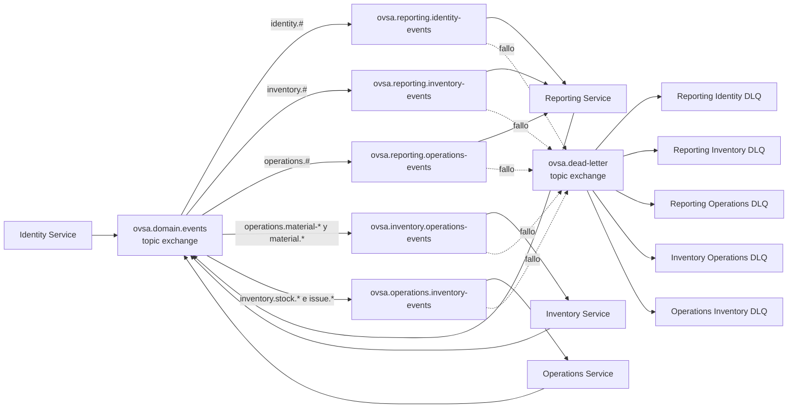

# Topología inicial de RabbitMQ

## 1. Propósito

Este documento define la estructura inicial de exchanges, routing keys, colas y dead-letter queues de OVSA.

La configuración real se implementará en Sprint 1.

---

# 2. Exchange principal

Nombre:

```text
ovsa.domain.events
```

Tipo:

```text
topic
```

Configuración:

* Durable.
* No auto-delete.
* Acceso autenticado.
* Publicación confirmada.
* Sin uso como almacenamiento permanente.

Todos los eventos empresariales versionados serán publicados inicialmente en este exchange.

---

# 3. Routing key

La routing key será igual al tipo del evento.

Ejemplo:

```text
inventory.receipt.confirmed.v1
```

Esto permitirá bindings como:

```text
inventory.#
operations.work-order.#
identity.employee.#
```

---

# 4. Colas de Reporting

Reporting necesita eventos de Identity, Inventory y Operations.

## Cola de eventos de Identity

```text
ovsa.reporting.identity-events
```

Binding:

```text
identity.#
```

DLQ:

```text
ovsa.reporting.identity-events.dlq
```

## Cola de eventos de Inventory

```text
ovsa.reporting.inventory-events
```

Binding:

```text
inventory.#
```

DLQ:

```text
ovsa.reporting.inventory-events.dlq
```

## Cola de eventos de Operations

```text
ovsa.reporting.operations-events
```

Binding:

```text
operations.#
```

DLQ:

```text
ovsa.reporting.operations-events.dlq
```

Se utilizarán colas separadas para aislar fallos y observar mejor cada dominio.

---

# 5. Cola de Inventory para Operations

Inventory podrá consumir solicitudes empresariales publicadas por Operations cuando el flujo asíncrono esté justificado.

Cola inicial:

```text
ovsa.inventory.operations-events
```

Bindings previstos:

```text
operations.material-request.created.v1
operations.material-request.approved.v1
operations.material.returned.v1
```

DLQ:

```text
ovsa.inventory.operations-events.dlq
```

La primera implementación de reserva podrá utilizar REST si Operations necesita conocer inmediatamente el resultado.

El evento seguirá siendo útil para auditoría y procesos posteriores.

---

# 6. Cola de Operations para Inventory

Operations consumirá resultados relevantes de Inventory.

Cola inicial:

```text
ovsa.operations.inventory-events
```

Bindings previstos:

```text
inventory.stock.reserved.v1
inventory.stock.reservation-released.v1
inventory.issue.confirmed.v1
inventory.transfer.completed.v1
```

DLQ:

```text
ovsa.operations.inventory-events.dlq
```

---

# 7. Dead-letter exchange

Nombre inicial:

```text
ovsa.dead-letter
```

Tipo:

```text
topic
```

Las colas principales enviarán a este exchange los mensajes que no puedan procesarse.

Cada DLQ deberá conservar la relación con su cola original.

---

# 8. Diagrama



---

# 9. Credenciales

Cada servicio tendrá su propio usuario técnico.

Ejemplos conceptuales:

```text
ovsa_identity_service
ovsa_inventory_service
ovsa_operations_service
ovsa_reporting_service
```

Cada usuario tendrá solamente permisos necesarios.

Ejemplos:

* Identity podrá publicar eventos `identity.*`.
* Inventory podrá publicar `inventory.*`.
* Operations podrá publicar `operations.*`.
* Reporting podrá publicar `reporting.*`.
* Reporting podrá consumir solamente sus colas.
* Un servicio no administrará globalmente el broker.

Las contraseñas no se almacenarán en Git.

---

# 10. Convención de colas

Las colas utilizarán:

```text
ovsa.<consumer>.<purpose>
```

Ejemplos:

```text
ovsa.reporting.inventory-events
ovsa.operations.inventory-events
```

Las DLQ utilizarán:

```text
<nombre-cola>.dlq
```

---

# 11. Durabilidad

Los elementos empresariales serán inicialmente:

* Exchanges durables.
* Colas durables.
* Mensajes persistentes.
* Confirmación del productor.
* Acknowledgement manual del consumidor.

La durabilidad reduce el riesgo, pero no reemplaza:

* Backups.
* Outbox.
* Idempotencia.
* Monitoreo.
* Reintentos controlados.

---

# 12. Prefetch

Los consumidores utilizarán un prefetch limitado.

Esto evita que un consumidor reciba demasiados mensajes sin procesar.

El valor definitivo se determinará mediante pruebas.

No se configurará un número elevado sin observar:

* Tiempo de procesamiento.
* Memoria.
* Concurrencia.
* Orden requerido.
* Capacidad de la base de datos.

---

# 13. Ambientes

Cada ambiente tendrá infraestructura y credenciales separadas.

Ejemplos:

```text
development
staging
production
```

No se mezclarán eventos de producción con eventos de pruebas.

La separación podrá realizarse mediante:

* Brokers independientes.
* Virtual hosts independientes.
* Credenciales independientes.

---

# 14. Regla principal

Una cola pertenece al consumidor, no al productor.

El productor publica hechos en un exchange y no necesita conocer todas las colas que reaccionarán a ellos.