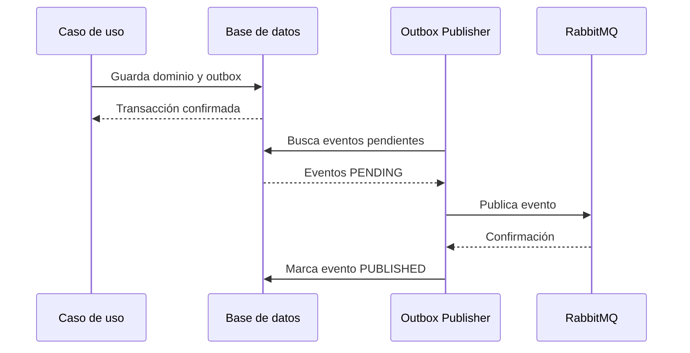
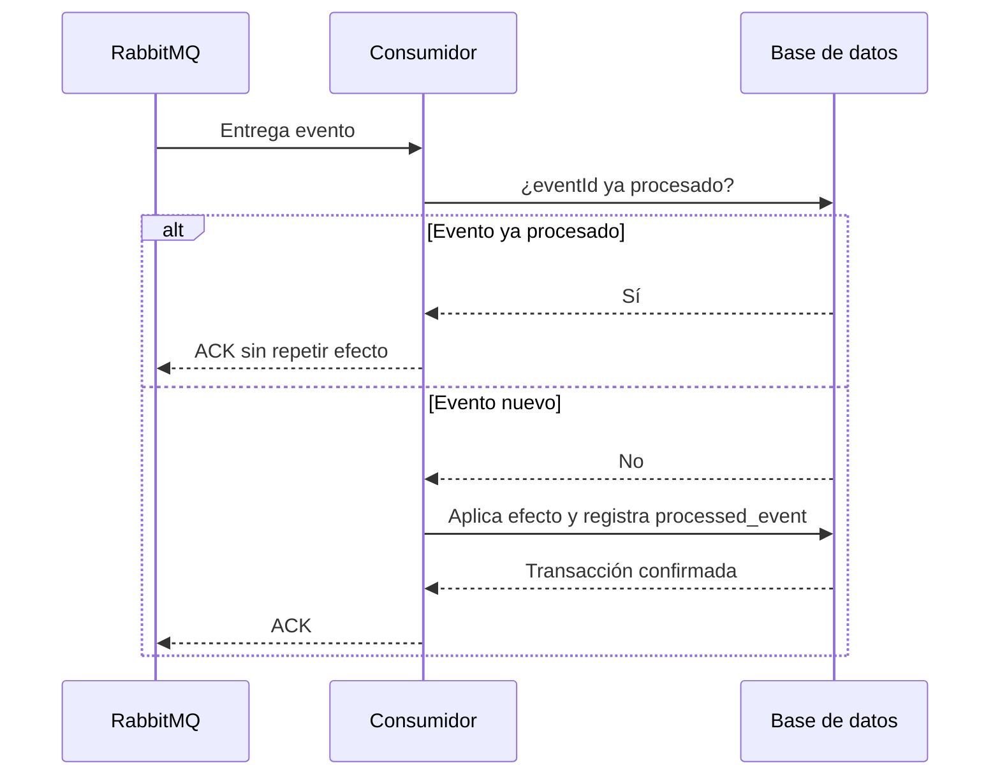

# Confiabilidad de eventos

## 1. Propósito

Este documento define cómo OVSA evitará la pérdida, duplicación y repetición infinita de eventos.

La entrega distribuida no puede asumir que:

* La red siempre funciona.
* RabbitMQ siempre responde.
* El consumidor siempre está disponible.
* Un mensaje se entregará exactamente una vez.
* Un proceso completo podrá ejecutarse en una sola transacción.

---

# 2. Problema de publicación dual

Supongamos que Inventory confirma una entrada.

Debe realizar dos acciones:

1. Guardar la entrada y actualizar el stock.
2. Publicar `inventory.receipt.confirmed.v1`.

Una implementación insegura podría hacer:

```text
Guardar en MySQL
        ↓
Publicar en RabbitMQ
```

Si MySQL confirma, pero RabbitMQ falla, tendremos:

* La entrada confirmada.
* El stock actualizado.
* Ningún evento publicado.

El sistema quedaría inconsistente.

---

# 3. Outbox Pattern

Cada microservicio tendrá una tabla `outbox_event`.

Dentro de una misma transacción local:

1. Se modifica el dominio.
2. Se guardan los cambios empresariales.
3. Se guarda el evento en `outbox_event`.
4. La transacción se confirma.

Después, un publicador independiente lee los eventos pendientes y los envía a RabbitMQ.



---

# 4. Modelo conceptual de outbox

La tabla tendrá inicialmente campos equivalentes a:

```text
outbox_event
- id
- organization_id
- aggregate_type
- aggregate_id
- event_type
- event_version
- payload
- metadata
- correlation_id
- causation_id
- occurred_at
- status
- attempt_count
- next_attempt_at
- published_at
- last_error
- created_at
```

Estados iniciales:

```text
PENDING
PROCESSING
PUBLISHED
FAILED
```

## Reglas

* El registro outbox se guardará en la misma base del productor.
* Se guardará dentro de la misma transacción empresarial.
* El publicador deberá soportar varios procesos concurrentes.
* Los eventos publicados se conservarán durante un periodo definido.
* Los errores no deberán almacenar secretos.
* Un evento no será eliminado inmediatamente después de publicarse.

---

# 5. Confirmación del productor

El productor deberá utilizar confirmación de publicación cuando RabbitMQ lo permita.

Solo se marcará el evento como `PUBLISHED` después de recibir una confirmación válida del broker.

Si la confirmación no llega, el evento permanecerá pendiente o volverá a intentarse.

Esto puede provocar una publicación duplicada, pero es preferible a perder el evento.

---

# 6. Entrega al menos una vez

OVSA asumirá entrega **at least once**.

Esto significa:

* Un evento debería llegar.
* En algunas situaciones puede llegar más de una vez.
* El consumidor debe soportar duplicados.

No se prometerá procesamiento exactamente una vez entre servicios.

---

# 7. Consumidores idempotentes

Cada consumidor registrará los eventos procesados.

Modelo conceptual:

```text
processed_event
- event_id
- consumer_name
- event_type
- source
- processed_at
```

La clave primaria conceptual será:

```text
event_id + consumer_name
```

Esto permite que consumidores diferentes procesen el mismo evento, pero cada uno lo procese una sola vez.

## Flujo



El efecto empresarial y el registro `processed_event` deberán guardarse en la misma transacción local del consumidor.

---

# 8. Reintentos

Los errores temporales podrán reintentarse.

Política inicial conceptual:

```text
Intento 1: procesamiento inicial
Intento 2: después de aproximadamente 10 segundos
Intento 3: después de aproximadamente 60 segundos
Intento 4: después de aproximadamente 5 minutos
Después: dead-letter queue
```

Los tiempos definitivos serán configurables.

## Errores reintentables

* Timeout.
* Conexión temporalmente no disponible.
* Bloqueo transitorio.
* Dependencia técnica recuperable.
* Error temporal del almacenamiento.

## Errores no reintentables

* JSON inválido.
* Evento no reconocido.
* Versión no soportada.
* Campo obligatorio ausente.
* Identificador mal formado.
* Regla imposible de ejecutar.
* Violación permanente del contrato.

Un error permanente deberá enviarse directamente a la DLQ o después de un número muy limitado de intentos.

---

# 9. Dead-letter queue

Cada cola empresarial tendrá una dead-letter queue asociada.

Una DLQ conservará mensajes que no pudieron procesarse.

Ejemplo:

```text
Cola principal:
ovsa.reporting.inventory-events

DLQ:
ovsa.reporting.inventory-events.dlq
```

La DLQ permitirá:

* Investigar el error.
* Revisar el evento.
* Corregir el consumidor.
* Reprocesar manualmente cuando sea seguro.
* Mantener evidencia del fallo.

Un mensaje no deberá regresar automáticamente desde la DLQ a la cola principal en un ciclo infinito.

---

# 10. Acknowledgements

El consumidor enviará `ACK` solamente después de:

* Validar el evento.
* Aplicar el efecto.
* Confirmar la transacción local.
* Registrar el evento procesado.

Si falla antes de confirmar la transacción, no deberá confirmar exitosamente el mensaje.

---

# 11. Poison messages

Un poison message es un mensaje que falla cada vez que se intenta procesar.

Ejemplos:

* Payload incompatible.
* Campo requerido inexistente.
* Valor imposible.
* Versión desconocida.

Los poison messages deben llegar a la DLQ sin bloquear indefinidamente la cola principal.

---

# 12. Observabilidad

Se crearán métricas para:

* Eventos pendientes en outbox.
* Eventos publicados.
* Errores de publicación.
* Mensajes consumidos.
* Mensajes duplicados.
* Reintentos.
* Mensajes en DLQ.
* Tiempo de procesamiento.
* Antigüedad del evento más viejo pendiente.

Los logs incluirán:

```text
eventId
eventType
correlationId
aggregateId
producer
consumer
attempt
result
```

---

# 13. Recuperación

Cuando un mensaje termine en DLQ:

1. Se identifica la causa.
2. Se corrige el problema.
3. Se verifica si reprocesarlo es seguro.
4. Se registra quién autorizó la operación.
5. Se republica conservando el `eventId` original.
6. El consumidor aplica su control de idempotencia.

No se cambiará silenciosamente el evento histórico.

---

# 14. Retención

La retención definitiva se establecerá según:

* Volumen.
* Auditoría.
* Costos.
* Necesidad de recuperación.
* Requisitos legales.

Inicialmente:

* Los eventos outbox publicados no se eliminarán inmediatamente.
* Los eventos procesados tendrán retención suficiente para evitar duplicados.
* Los mensajes de DLQ requerirán revisión y política explícita.
* Los archivos históricos podrán archivarse.

---

# 15. Regla principal

OVSA preferirá procesar ocasionalmente un evento duplicado antes que perder silenciosamente un evento empresarial.

La idempotencia deberá convertir ese duplicado en una operación segura.