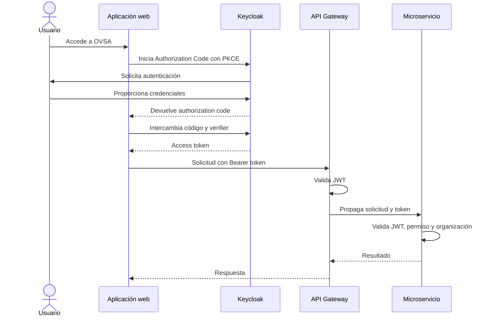

# Contenido de `docs/security/security-model.md`

# Modelo general de seguridad

## 1. Propósito

Este documento define la arquitectura de seguridad de OVSA Enterprise Operations.

OVSA utilizará:

* OpenID Connect para autenticación.
* OAuth2 para autorización delegada.
* Keycloak como proveedor de identidad.
* JWT firmados como access tokens.
* Spring Security en el gateway y microservicios.
* Roles y permisos empresariales.
* Aislamiento por organización.
* Auditoría de operaciones críticas.

---

## 2. Componentes

### Keycloak

Será responsable de:

* Autenticar usuarios.
* Administrar credenciales.
* Aplicar políticas de acceso.
* Administrar sesiones.
* Emitir tokens.
* Publicar claves públicas.
* Permitir recuperación de acceso.
* Incorporar autenticación multifactor.

Keycloak no será propietario de:

* Productos.
* Stock.
* Órdenes de trabajo.
* Movimientos empresariales.
* Reglas específicas de inventario.

### Identity Service

Será la fuente oficial de:

* Organizaciones.
* Usuarios empresariales.
* Trabajadores.
* Roles empresariales.
* Permisos.
* Asignaciones de roles.
* Estado empresarial del usuario.

Identity Service sincronizará con Keycloak la información necesaria para emitir tokens autorizados.

### API Gateway

Será responsable de:

* Recibir solicitudes externas.
* Validar inicialmente access tokens.
* Rechazar tokens inválidos.
* Aplicar CORS.
* Aplicar límites de solicitudes.
* Propagar el token al servicio de destino.
* Generar o propagar `X-Correlation-ID`.
* Aplicar encabezados de seguridad.

El gateway no será la única capa de seguridad.

### Microservicios

Cada microservicio será responsable de:

* Validar nuevamente el JWT.
* Validar emisor.
* Validar audiencia.
* Validar vigencia.
* Extraer la organización.
* Extraer roles y permisos.
* Autorizar endpoints.
* Autorizar recursos concretos.
* Aplicar reglas empresariales.
* Registrar acciones importantes.

### Aplicación web

La aplicación web podrá:

* Iniciar el flujo de autenticación.
* Mantener información de sesión necesaria.
* Ocultar acciones no autorizadas para mejorar la experiencia.
* Enviar el access token al gateway.

La aplicación web no será una autoridad de seguridad.

Ocultar un botón no reemplaza la validación en el backend.

---

## 3. Flujo de autenticación



---

## 4. Validaciones del token

El gateway y cada microservicio deberán validar:

* Firma criptográfica.
* Algoritmo permitido.
* Emisor esperado.
* Audiencia esperada.
* Fecha de expiración.
* Fecha de validez inicial.
* Identificador del sujeto.
* Organización cuando corresponda.
* Cliente autorizado.
* Estructura de claims.

No se confiará en un token solamente porque pueda decodificarse.

---

## 5. Autorización por capas

La autorización tendrá cuatro niveles.

### Nivel 1: endpoint

Determina si el usuario puede ejecutar una función.

Ejemplo:

```text
receipt:confirm
```

### Nivel 2: organización

Determina si el recurso pertenece a la organización autorizada.

### Nivel 3: objeto

Determina si el usuario puede acceder al recurso concreto.

Ejemplo:

* Orden asignada al trabajador.
* Bodega autorizada para el operador.
* Reporte perteneciente a la organización.

### Nivel 4: regla empresarial

Determina si la acción es válida según el estado del dominio.

Ejemplo:

Un usuario puede tener `receipt:confirm`, pero no puede confirmar una entrada que ya está confirmada.

---

## 6. Confianza entre componentes

```text
Internet
   ↓
Aplicación web
   ↓
API Gateway
   ↓
Microservicios
   ↓
Bases de datos y mensajería
```

Cada límite deberá asumir que los datos recibidos pueden ser incorrectos o maliciosos.

No se confiará automáticamente en una solicitud solamente porque provenga de la red interna.

---

## 7. Respuestas de seguridad

### 401 Unauthorized

Se utilizará cuando:

* No existe token.
* El token es inválido.
* El token expiró.
* El emisor no es válido.
* La firma no es válida.

### 403 Forbidden

Se utilizará cuando:

* El token es válido.
* El usuario está autenticado.
* El usuario no posee el permiso necesario.

### 404 Not Found

Podrá utilizarse cuando un recurso:

* No existe.
* Existe en otra organización.
* Está fuera del alcance permitido.

Esto evita revelar innecesariamente la existencia de recursos ajenos.

---

## 8. Transporte

En entornos distintos de desarrollo local:

* Todo acceso externo utilizará HTTPS.
* No se permitirán tokens mediante URL.
* No se enviarán credenciales por canales sin cifrar.
* Los endpoints administrativos tendrán exposición limitada.
* Las conexiones internas sensibles deberán protegerse según el entorno.

---

## 9. Logs

Los logs podrán registrar:

* `userId`.
* `organizationId`.
* `clientId`.
* `correlationId`.
* Acción.
* Resultado.
* Código de error.
* Dirección IP tratada según la política de privacidad.

Los logs no deberán registrar:

* Contraseñas.
* Access tokens.
* Refresh tokens.
* Client secrets.
* Cookies completas.
* Claves privadas.
* Datos personales innecesarios.

---

## 10. Secretos

Los secretos deberán mantenerse fuera del repositorio.

En desarrollo local podrán inyectarse mediante:

* Variables de entorno.
* Archivo `.env` ignorado por Git.
* Secretos de Docker.

En producción deberán administrarse mediante una solución apropiada de gestión de secretos.

---

## 11. Regla principal

La seguridad se aplicará cerca del recurso protegido.

El gateway proporciona una primera barrera, pero cada microservicio será responsable de defender sus propias operaciones y datos.